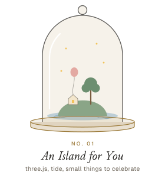
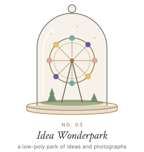
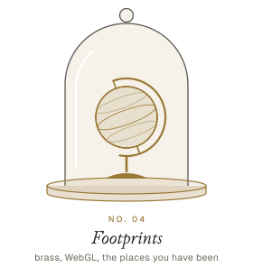
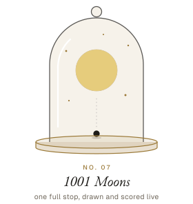

<picture>
  <source media="(prefers-color-scheme: dark)" srcset="assets/hero-dark.svg">
  
</picture>

<picture>
  <source media="(prefers-color-scheme: dark)" srcset="assets/label-dark.svg">
  
</picture>

<picture>
  <source media="(prefers-color-scheme: dark)" srcset="assets/on-view-dark.svg">
  
</picture>

<!-- shelf -->

<a href="https://island-for-you.vercel.app"><picture><source media="(prefers-color-scheme: dark)" srcset="assets/jar-island-dark.svg"></picture></a>
<a href="https://birthday-stays-open.vercel.app"><picture><source media="(prefers-color-scheme: dark)" srcset="assets/jar-birthday-dark.svg"></picture></a>
<a href="https://wonderpark-publiccp4hwz.vercel.app"><picture><source media="(prefers-color-scheme: dark)" srcset="assets/jar-wonderpark-dark.svg"></picture></a>

<a href="https://footprints-globe.vercel.app"><picture><source media="(prefers-color-scheme: dark)" srcset="assets/jar-footprints-dark.svg"></picture></a>
<a href="https://tearable-almond-blossom.vercel.app"><picture><source media="(prefers-color-scheme: dark)" srcset="assets/jar-blossom-dark.svg"></picture></a>
<a href="https://mistpane.vercel.app"><picture><source media="(prefers-color-scheme: dark)" srcset="assets/jar-mistpane-dark.svg"></picture></a>

<a href="https://1001moons.vercel.app"><picture><source media="(prefers-color-scheme: dark)" srcset="assets/jar-moons-dark.svg"></picture></a>
<a href="https://bloom1-kappa.vercel.app"><picture><source media="(prefers-color-scheme: dark)" srcset="assets/jar-bloom-dark.svg"></picture></a>
<a href="https://learn-ancient-character.vercel.app"><picture><source media="(prefers-color-scheme: dark)" srcset="assets/jar-shigu-dark.svg"></picture></a>

<!-- /shelf -->

<picture>
  <source media="(prefers-color-scheme: dark)" srcset="assets/colophon-dark.svg">
  
</picture>

<a href="https://carpediemzzsssww-cpu.github.io/Iris/">The full collection</a> &nbsp;·&nbsp; <a href="https://www.xiaohongshu.com/user/profile/5d32cb0c0000000016005832">Xiaohongshu</a> &nbsp;·&nbsp; <a href="mailto:carpediemzzsssww@gmail.com">carpediemzzsssww@gmail.com</a>

